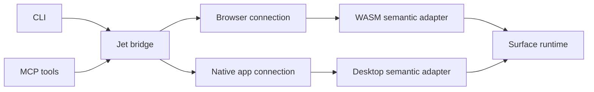

# Application bridge boundary

The user requested desktop MCP/CLI access and WASM access through the Jet
bridge. This document defines the next implementation slice. It is a plan,
not evidence that the adapters below already work.

## Responsibility

Surface owns UI state, node identity, layout, focus, editing and actions.
Jet bridge owns CLI/MCP tools, browser transport and native connections.
Jet keeps its build tool and uses the standalone bridge as a dependency.

The browser connection can still drive HTML pages. Canvas UI inspection
must call the semantic adapter. It cannot infer Rust nodes from pixels.
Playwright can remain a browser comparison tool. Runtime acceptance should
also exercise the extracted bridge itself.

## Shared operations

Use one versioned request/response format for desktop and WASM:

- Read the current DOM, layout and interaction/editor state.
- Query stable IDs, roles and accessible names.
- Activate a control, fill a field, change a range or send an editing key.
- Return explicit errors for missing, disabled, read-only or blocked controls.
- Report capabilities; do not pretend that legacy hook/fiber APIs exist on
  the new Surface application runtime.

Actions must use Surface's normal runtime paths and controlled app state.
Snapshots must describe the current tree. Pending geometry stays absent
until the renderer supplies matching bounds. A stale node reference must
not silently select a different node.

## Transport

The planned native host opts into a local connection. Requests enter the
window event loop. UI state stays on its owning thread. A private session
descriptor identifies the exact app and connection. The bridge must not
discover or control unrelated user applications.

The planned WASM adapter exposes a version/capability handshake and the
same semantic operations. A separate global adapter should coexist with
Jet's existing `window.__jet_debug` API. The Surface app must not imitate
hook/fiber methods it does not implement.

Keep the transport schema small. Surface must not pull Chromium, the CLI
or the MCP server into its application/renderer dependency graph.

## Acceptance still required

- Standalone CLI and MCP serve real browser requests.
- Existing Jet commands and consumer acceptance tests still pass.
- A running native Surface window exports its real current tree through
  CLI and MCP, then shows state changes from semantic actions.
- A running Surface WASM app passes the same operations through the
  extracted bridge, including Chinese controlled input and modal focus.
- Imported MCP protocol compatibility is stated explicitly. The initial
  server speaks the imported 2025-06-18 contract; the newer protocol must
  not be claimed without its own conformance checks.
