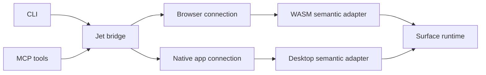

# Application bridge boundary

One protocol serves desktop MCP/CLI access and WASM access through the Jet
bridge. This document defines each repository's responsibility and records
the implemented consumer checks below.

## Responsibility

Surface owns UI state, node identity, layout, focus, editing and actions.
Jet bridge owns CLI/MCP tools, browser transport and native connections.
Jet keeps its build tool and uses the standalone bridge as a dependency.

The browser connection can still drive HTML pages. Canvas UI inspection
must call the semantic adapter. It cannot infer Rust nodes from pixels.
Playwright can remain a browser comparison tool. Runtime acceptance should
also exercise the extracted bridge itself.

## Shared operations

Use one versioned request/response format for desktop and WASM:

- Read the current DOM, layout and interaction/editor state.
- Query stable IDs, roles and accessible names.
- Activate a control, fill a field, change a range or send an editing key.
- Return explicit errors for missing, disabled, read-only or blocked controls.
- Report capabilities; do not pretend that legacy hook/fiber APIs exist on
  the new Surface application runtime.

Actions must use Surface's normal runtime paths and controlled app state.
Snapshots must describe the current tree. Pending geometry stays absent
until the renderer supplies matching bounds. A stale node reference must
not silently select a different node.

## Transport

The native host opts into a local connection. Requests enter the
window event loop. UI state stays on its owning thread. A private session
descriptor identifies the exact app and connection. The bridge must not
discover or control unrelated user applications.

The WASM adapter exposes a version/capability handshake and the
same semantic operations. A separate global adapter should coexist with
Jet's existing `window.__jet_debug` API. The Surface app must not imitate
hook/fiber methods it does not implement.

Keep the transport schema small. Surface must not pull Chromium, the CLI
or the MCP server into its application/renderer dependency graph.

## Qualified paths

| Path | Evidence |
| --- | --- |
| Browser CLI/MCP | Real Chromium fixture, Chinese DOM events, shared state, PNG and actual process exit; `scripts/live-browser.py` |
| Jet consumer | [Jet #76](https://github.com/faberline/jet/pull/76) at `ffb1635803e96319529b82b0bceb8668b6846062`; actual local browser/MCP/debug-WASM journeys and preserved cross-module cases |
| Surface native | [Surface #3](https://github.com/faberline/surface/pull/3) at `bcc31c92f0bf74ea75a25d57b04cfb8c9905906f`; macOS GPU window, real CLI/MCP snapshots and controlled actions |
| Surface WASM | Same Surface revision; Chrome 157 WebGPU, same actions, PNG and actual browser exit |
| MCP contract | Imported `2025-06-18`; official Python SDK initialize/list/error interoperability; 27 browser tools or seven semantic tools |

Surface's `scripts/bridge-e2e.py` checks real controlled Chinese input,
saved state, range snapping, disabled and removed nodes, modal scope,
Tab loops and restored focus. Its native fixture also checks authentication,
private Unix descriptor permissions and normal cleanup. It uses no
Playwright runtime. Surface imports only the protocol crate at
`a21f93425f8f27dfc7ab2bea0c34fdebcc71335f`.

The hosted Jet parity workflow reports an unwired oracle and no results.
Its successful exit does not qualify hosted parity. Other native operating
systems, physical OS IME candidate windows, full Playwright parity and the
newer MCP protocol need their own runtime/conformance checks. All linked
changes remain draft PRs.
